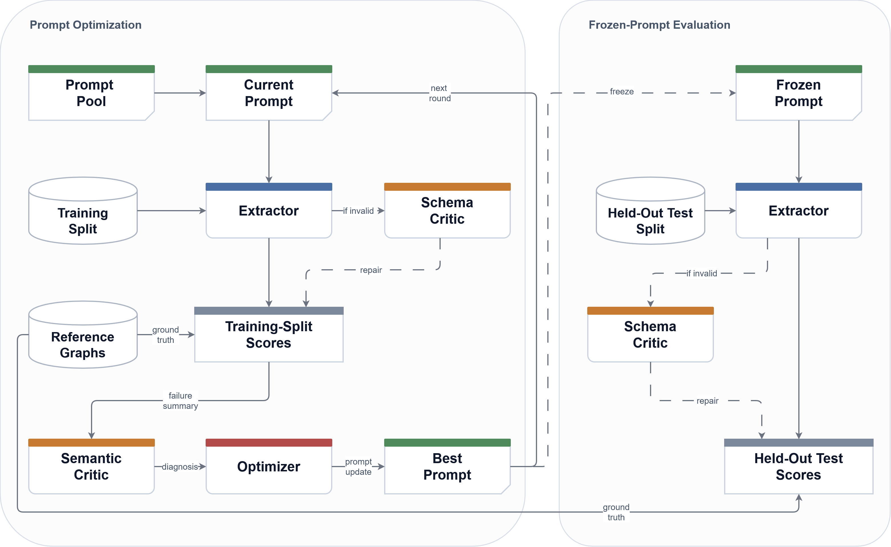
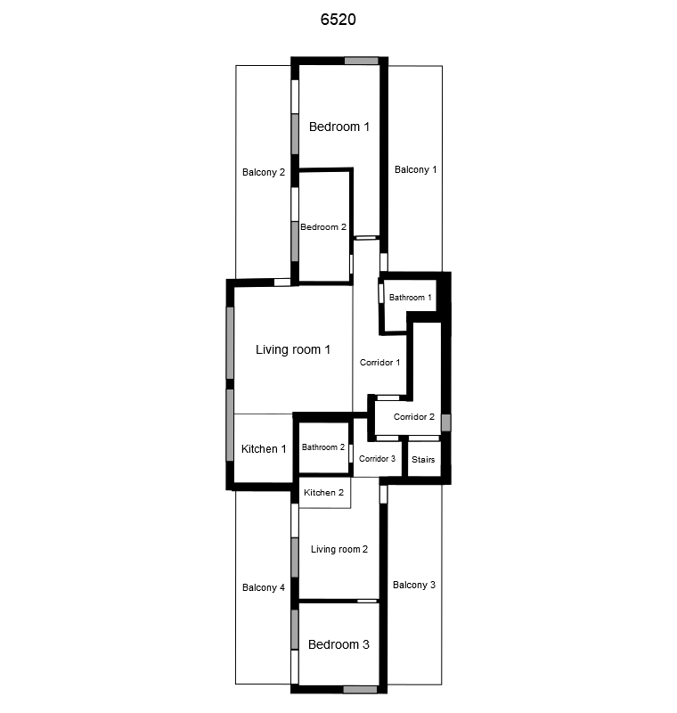
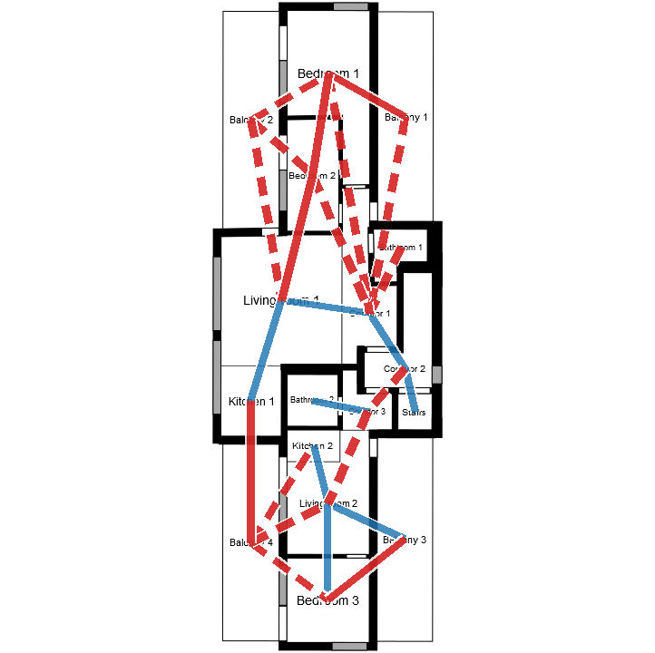
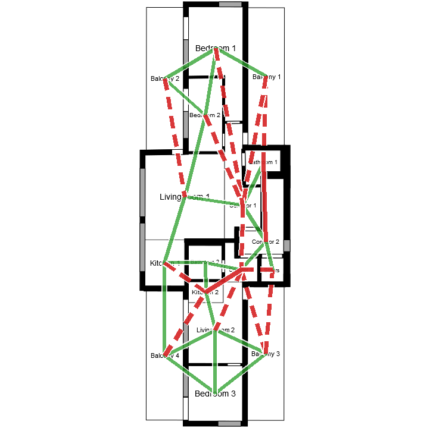

# Floor Plan Topology Extraction with Multimodal LLMs

This repository is a project page for my work as first author of the paper **"A Multimodal LLM-Based Approach to Generating Topology Graphs of Buildings from Floor Plan Images."**

The project investigates whether multimodal large language models can recover space-adjacency and connectivity graphs directly from architectural floor-plan images. It includes a reproducible extraction, normalization, validation, and repair pipeline, together with a reviewed 100-plan benchmark derived from the Modified Swiss Dwellings dataset.

*Figure 1 — Automatic prompt optimization on the training split followed by frozen-prompt evaluation on the held-out test split. Predictions pass through extraction, schema validation and repair before being scored against reviewed reference graphs.*

### Example result: floor plan 6520

Floor plan 6520 is a representative hard case from the held-out test split. The source plan is shown alongside the selected GPT-4.1/5.1 run for connectivity and adjacency extraction.

| Source floor plan | Connectivity overlay | Adjacency overlay |
| --- | --- | --- |
|  |  |  |

*Figure 2 — Correct predicted adjacency edges are green and correct predicted connectivity edges are blue. Dashed red lines show reference relations missed by the prediction; solid red lines show unexpected predicted relations. This case highlights the remaining difficulty of interpreting ambiguous boundaries and access relations.*

## Project links

- **Official source code, benchmark, prompts, and run artifacts:** [Design Computation, RWTH Aachen University GitLab](https://git-ce.rwth-aachen.de/design-computation/eg-ice-2026-mllm-topology-graph)
- **Research group:** [Design Computation, RWTH Aachen University](https://dc.rwth-aachen.de/)

The authoritative repository is maintained on the university GitLab. This GitHub repository intentionally contains only this project overview so there is one source of truth for the research artifacts and their history.

## Authors

Georgi Tsakov, Tobias Heimig-Elschner, Jyrki Oraskari, Vera-Teodora Mandalac, Anna Scheuvens, Oliver Schulz, and Jakob Beetz.

## Repository scope

The official repository includes:

- floor-plan topology extraction using multimodal LLMs;
- structured prompting and validation-based graph repair;
- scoring of adjacency and connectivity predictions;
- a reviewed benchmark with fixed training and test splits;
- retained evaluation artifacts; and
- BOT-compatible Turtle export.
